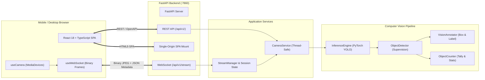

# 👁️ AI Smart Camera
### Real-Time Computer Vision Platform | FastAPI + React 18 + YOLO & Supervision

[](https://colab.research.google.com/github/tahadeab-ai/ai-smart-camera/blob/main/notebooks/01_ai_smart_camera_colab.ipynb)
[](https://github.com/tahadeab-ai/ai-smart-camera/actions/workflows/ci.yml)
[](https://github.com/tahadeab-ai/ai-smart-camera/actions/workflows/docker-build.yml)
[](https://fastapi.tiangolo.com/)
[](https://react.dev/)
[](https://opensource.org/licenses/MIT)
[](https://www.python.org/)
[](https://docs.ultralytics.com/)
[](https://supervision.roboflow.com/)

---

## 1. Project Introduction

**AI Smart Camera v0.2.0** is an enterprise-grade, edge-ready Computer Vision web application delivering real-time object detection, classification, annotation, and counting. 

Engineered with a **FastAPI backend**, an interactive **React 18 + TypeScript + Vite frontend**, and a low-latency **WebSocket streaming protocol**, the application runs edge computer vision models directly in any browser—supporting mobile phone cameras (with rear/front lens switching) and desktop webcams over public HTTPS tunnels without installing local dependencies.

---

## 2. Architecture & Design Principles

The application decouples presentation, video streaming, computer vision, and deep learning into a clean three-layer architecture:



---

## 3. Key Features

- 📹 **Real-Time WebSocket Streaming (`/api/v1/stream`)**: Sub-20ms bi-directional communication protocol streaming binary JPEG frames paired with synchronized JSON telemetry.
- 📱 **Mobile Camera Flipping**: One-tap toggle between selfie webcam (`user`) and high-definition smartphone rear lens (`environment`).
- 🔄 **Flicker-Free Frame Decimation**: Resolved the frame-skipping bug through per-session state caching in `StreamManager`. Skipped frames re-annotate the moving background in <1ms without dropping bounding boxes or counts to zero.
- 🖼️ **Static Image Analysis**: Upload JPEG, PNG, or WebP images up to 20MB with side-by-side comparison, bounding box inspection table, and JSON results export.
- ⚙️ **Thread-Safe Model Switcher**: Dynamic runtime reloading between YOLOv8n and YOLO11n without service restarts.
- 🔒 **Public Colab Security**: Ephemeral token authentication (`APP_ACCESS_TOKEN`) protecting public Cloudflare tunnels against unauthorized access.
- 🐳 **Multi-Stage Docker Architecture**: Production Node.js 20 build stage compiled into a single-origin Python 3.11-slim container.

---

## 4. API Specification & Endpoints

| Method | Endpoint | Description |
| :--- | :--- | :--- |
| `GET` | `/api/v1/health/live` | Kubernetes/Docker liveness probe |
| `GET` | `/api/v1/health/ready` | Readiness probe (verifies model readiness) |
| `GET` | `/api/v1/system/info` | Hardware telemetry, CUDA status, and active streams |
| `GET` | `/api/v1/models` | List supported models and active state |
| `POST` | `/api/v1/models/switch` | Thread-safe active model reloading |
| `POST` | `/api/v1/detect/image` | Static image detection returning boxes & base64 image |
| `WS` | `/api/v1/stream` | Real-time bi-directional camera streaming |
| `GET` | `/docs` | Interactive Swagger OpenAPI documentation |

---

## 5. Quickstart: Google Colab (Zero Local Setup)

Run the entire application remotely in Google Colab with GPU or CPU acceleration:

1. Open the [Official Interactive Notebook](https://colab.research.google.com/github/tahadeab-ai/ai-smart-camera/blob/main/notebooks/01_ai_smart_camera_colab.ipynb).
2. Run Section 1–8 to build the React frontend and initialize the FastAPI backend.
3. Run Section 9 to generate a public Cloudflare Quick Tunnel (`https://*.trycloudflare.com`).
4. Open the generated HTTPS URL on your smartphone or desktop to test live camera streaming.

---

## 6. Docker Deployment

Deploy the single-origin containerized microservice:

```bash
# Build multi-stage image
docker build -t ai-smart-camera:0.2.0 .

# Run container
docker run -d -p 7860:7860 --name ai-smart-camera ai-smart-camera:0.2.0

# Verify health
curl http://localhost:7860/api/v1/health/live

# Access in browser
open http://localhost:7860/
```

Or with Docker Compose:

```bash
docker compose up -d
```

---

## 7. Automated Testing & Verification

The test suite validates the entire application stack:

```bash
# Run backend unit and integration tests with coverage
pytest -v tests/ --cov=app --cov-report=term-missing

# Lint codebase with Ruff
ruff check .

# Benchmark pipeline
python benchmarks/benchmark.py --model yolov8n --device cpu --runs 30
```

---

## 8. License

This project is open-source under the [MIT License](LICENSE). 
YOLO weights are loaded dynamically from official sources under their respective upstream licenses ([AGPL-3.0](https://github.com/ultralytics/ultralytics/blob/main/LICENSE)).
