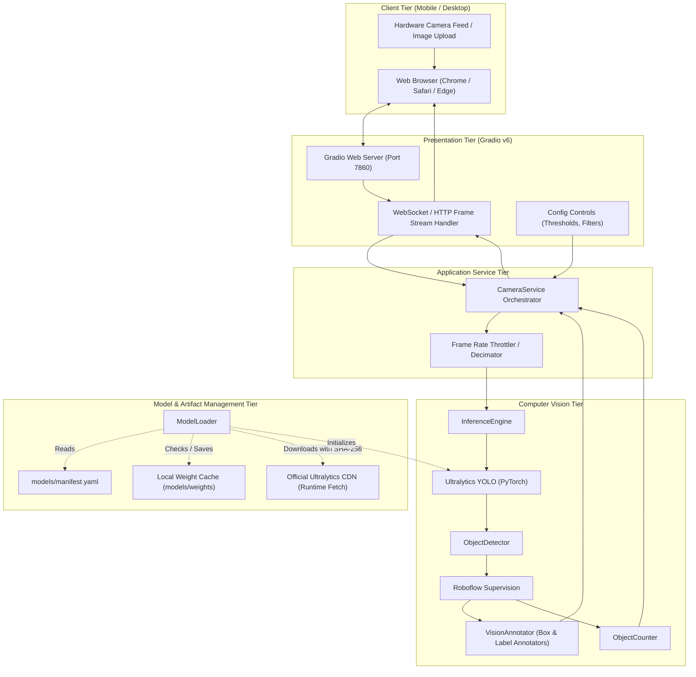

# Architecture Specification: AI Smart Camera

This document details the modular software architecture, data flow, component boundaries, and security considerations of the **AI Smart Camera** system.

---

## 1. System Overview & Data Flow

The application decouples user interface delivery, camera frame lifecycle management, computer vision processing, and deep learning execution into clear vertical layers.

---

## 2. Core Architectural Principles

### A. Strict Decoupling
- **Inference Independence**: `InferenceEngine` has zero dependencies on Gradio, OpenCV drawing functions, or UI elements. It takes standard image arrays and returns tensor predictions.
- **Vision Abstraction**: `ObjectDetector` maps raw tensor outputs to `supervision.Detections`. If model backends change (e.g., from PyTorch to ONNX Runtime or TensorRT), downstream annotation and counting remain unaffected.
- **Service Orchestration**: `CameraService` manages end-to-end processing without being tightly bound to Gradio. It can be wrapped in a FastAPI REST/WebSocket endpoint without code duplication.

### B. Frame Throttling & Latency Management
- Mobile and cellular video streaming encounters network jitter. The application provides `stream_every` parameterization and `skip_interval` frame decimation to prevent frame queue backpressure.
- If processing a frame encounters unexpected errors, `CameraService` catches the exception and returns the original frame, maintaining stream continuity without crashing the user session.

### C. Zero-Disk In-Memory Processing
- Camera streams and uploaded images are processed entirely within RAM buffers.
- No client images, video frames, or personally identifiable information are persisted to disk.

---

## 3. Directory & Component Mapping

| Module | Responsibility | Key Classes / Functions |
| :--- | :--- | :--- |
| `app.config` | Reads environment variables and manages defaults. | `AppSettings` |
| `app.core.model_loader` | Resolves, downloads, verifies SHA-256, and loads models. | `ModelLoader`, `ModelLoadingError` |
| `app.core.inference` | Runs YOLO inference and tracks execution latency. | `InferenceEngine` |
| `app.vision.detector` | Translates YOLO output to `sv.Detections` with filtering. | `ObjectDetector` |
| `app.vision.annotator` | Renders high-contrast bounding boxes and label cards. | `VisionAnnotator` |
| `app.vision.counter` | Computes counts and generates summary markdown tables. | `ObjectCounter` |
| `app.services.camera_service` | Orchestrates end-to-end camera and static image pipelines. | `CameraService` |
| `app.ui.gradio_app` | Assembles Gradio tabs, controls, and event listeners. | `create_gradio_app` |
| `app.main` | CLI entry point for Colab, Docker, or standalone runs. | `run_app` |
