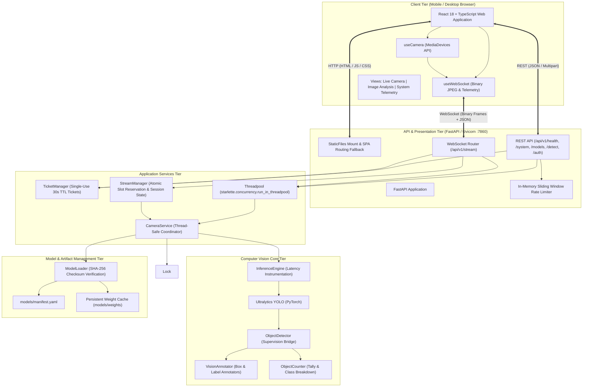
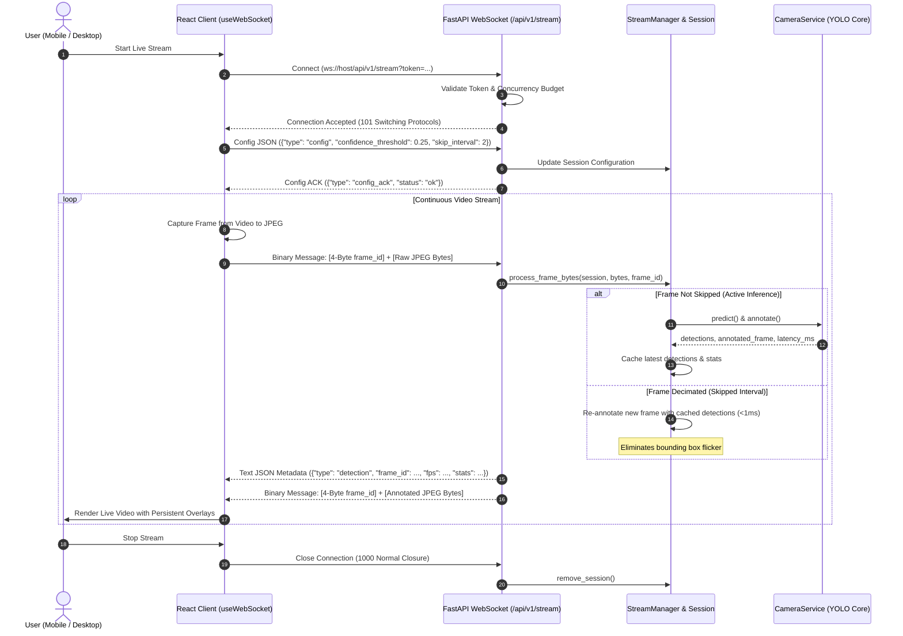

# Architecture Specification: AI Smart Camera v0.2.1

This document details the software architecture, component boundaries, WebSocket streaming protocol, and security considerations of the **AI Smart Camera v0.2.1** full-stack system.

---

## 1. System Architecture Overview

The system employs a production-grade three-layer architecture:
1. **Client Tier**: React 18 + TypeScript SPA using Vite, Tailwind CSS, and HTML5 MediaDevices.
2. **API & Service Tier**: FastAPI backend running under Uvicorn, serving the REST API (`/api/v1/`), real-time WebSocket stream (`/api/v1/stream`), single-use ticket authentication (`/api/v1/auth/ws-ticket`), and compiled static frontend assets from a single origin.
3. **Computer Vision Core Tier**: PyTorch YOLO models wrapped by Ultralytics and annotated using Roboflow Supervision, with CPU/GPU-bound tasks offloaded via `run_in_threadpool`.

---

## 2. WebSocket Streaming Protocol (`/api/v1/stream`)

The real-time camera streaming protocol guarantees deterministic frame-to-metadata association and avoids unbounded memory buildup through backpressure management.

### Sequence Flow

### Frame Decimation & Caching Specification
When `skip_interval > 1`:
- **Problem in v0.1.0**: On skipped frames, returning unannotated frames and 0 counts caused severe flickering.
- **Solution in v0.2.0**:
  - The `StreamSession` retains `last_detections` and `last_stats`.
  - On skipped frames, the new incoming frame is re-annotated with `last_detections` in <1 millisecond (pure OpenCV drawing).
  - The client receives the smoothly moving video feed, persistent bounding boxes, and accurate object statistics with zero model latency.

---

## 3. Public Colab Security Architecture

When deployed inside Google Colab via Cloudflare Quick Tunnel (`*.trycloudflare.com`):
1. **Access Token Authentication**:
   - A cryptographically random token (`secrets.token_hex(16)`) is generated at runtime and exported as `APP_ACCESS_TOKEN`.
   - Incoming REST requests must supply `X-Access-Token: <token>`.
   - WebSocket handshakes must supply `?token=<token>`.
   - If `APP_ACCESS_TOKEN` is unset, access defaults to open development mode.
2. **Rate Limiting & Concurrency**:
   - `MAX_CONCURRENT_STREAMS` (default: 5) rejects excessive WebSocket handshakes with status code `1013` (Try Again Later).
   - `MAX_UPLOAD_SIZE_MB` (default: 20MB) prevents memory exhaustion on image uploads with HTTP `413`.
