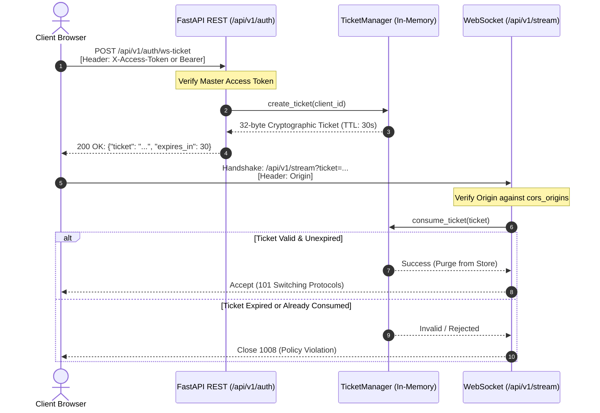

# Security Architecture & Threat Model: v0.2.1

## Overview

AI Smart Camera v0.2.1 introduces hardened defense-in-depth security mechanisms designed to protect public Google Colab tunnel endpoints, container deployments, and user data against malicious payloads, unauthorized access, and denial-of-service (DoS) vectors.

---

## 1. Static Image Ingestion Protection (`/api/v1/detect/image`)

Static file uploads represent a primary entry point for untrusted user inputs. The following controls are enforced:

### Early `Content-Length` Evaluation
- The server inspects the HTTP `Content-Length` header upfront.
- If the reported size exceeds `MAX_UPLOAD_SIZE_MB` (default: 20MB), the request is rejected immediately with **HTTP 413 (Payload Too Large)** before any body bytes are consumed.

### Bounded Chunk Streaming
- If `Content-Length` is absent, spoofed, or chunked-transfer-encoded, the server reads the upload in fixed **64 KB chunks** (`STREAM_CHUNK_SIZE = 64 * 1024`).
- A running byte counter accumulates chunks in memory. If cumulative bytes exceed the maximum threshold, reading is aborted immediately and **HTTP 413** is returned.

### Magic Byte Validation
Before any OpenCV parsing or decompression occurs, the header bytes are inspected against strict magic signatures:
- **JPEG**: `0xFF 0xD8 0xFF`
- **PNG**: `0x89 0x50 0x4E 0x47 0x0D 0x0A 0x1A 0x0A` (`\x89PNG\r\n\x1a\n`)
- **WebP**: Starts with `RIFF` and offset 8..12 matches `WEBP`

Corrupted files, executables, or mismatched formats trigger **HTTP 400 (INVALID_IMAGE_FORMAT)** without invoking decompression libraries.

### Decompression Bomb & Resolution Boundaries
To protect server memory against decompression bombs (e.g., highly compressed images expanding to gigabytes in memory):
- **Minimum resolution**: `10 x 10` pixels.
- **Maximum resolution**: `4096 x 4096` pixels.

Images outside these boundaries trigger **HTTP 400 (INVALID_IMAGE_DIMENSIONS)**.

### Resource Cleanup
All file handles are explicitly closed via `await file.close()` inside an unconditional `finally` block to prevent file descriptor leaks.

---

## 2. WebSocket Security & Single-Use Ticket Flow (`/api/v1/stream`)

WebSocket streaming presents unique security challenges because standard WebSocket handshakes in web browsers cannot include custom authorization headers like `X-Access-Token` or `Authorization: Bearer`.

### The Vulnerability of Permanent Query Tokens
Passing a master secret directly in a query parameter (`wss://host/stream?token=SECRET`) creates persistent leakage vectors:
1. Reverse proxy logs (Cloudflare, Nginx, Caddy) log full query strings in plaintext.
2. Browser history, developer console, and referrer headers expose the secret.
3. Browser extensions can inspect WebSocket URLs.

### Single-Use Ticket Solution
AI Smart Camera v0.2.1 implements a short-lived, single-use ticket mechanism:

### Key Ticket Properties
- **Entropy**: 32 bytes generated via `secrets.token_urlsafe(32)`.
- **Time-to-Live (TTL)**: 30 seconds.
- **Single-Use Invalidation**: The ticket is atomically popped from the in-memory store upon first validation. Any replay attempt fails with WebSocket close code `1008`.
- **In-Memory Retention**: The master secret is stored strictly in React memory state and never written to `localStorage`.

---

## 3. WebSocket Origin Validation

To defend against Cross-Site WebSocket Hijacking (CSWSH):
- Incoming WebSocket requests inspect the `Origin` header during handshake.
- If `settings.cors_origins` is configured (i.e. not `["*"]`), origins outside the allowed list are rejected immediately with close code **1008 (Policy Violation)**.

---

## 4. In-Memory Rate Limiting (`SlidingWindowRateLimiter`)

Both REST image detection and WebSocket ticket issuance are protected by an in-memory sliding window rate limiter:
- **Image Detection Quota**: 10 requests per minute per IP.
- **Ticket Issuance Quota**: 10 tickets per minute per IP.
- **Enforcement**: When exhausted, the server returns **HTTP 429 (Too Many Requests)** with a standardized error envelope and a `Retry-After: <seconds>` response header.

---

## 5. Non-Blocking Event Loop Protection

CPU-bound tasks (`cv2.imdecode`, PyTorch YOLO forward pass, `Supervision` box drawing, and `cv2.imencode`) are dispatched to a worker threadpool using `starlette.concurrency.run_in_threadpool`.

This prevents the asyncio event loop from stalling, guaranteeing that:
1. Health and liveness probes (`/health/live`) respond within <10ms.
2. Concurrent WebSocket heartbeats and ping/pong frames are processed without timeouts.
