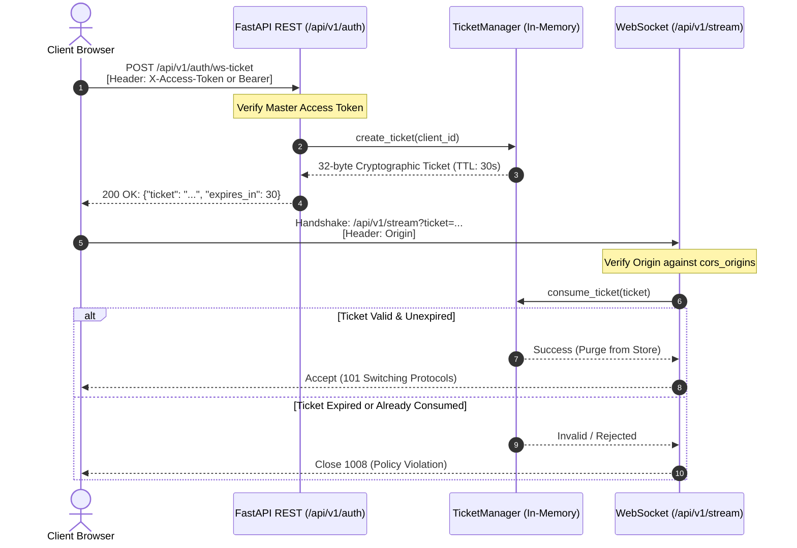

# Security Architecture & Threat Model: v0.2.2

## Overview

AI Smart Camera v0.2.2 establishes strict defense-in-depth security mechanisms designed to protect public Google Colab tunnel endpoints, container deployments, and user data against unauthorized access, Cross-Site WebSocket Hijacking (CSWSH), denial-of-service (DoS) memory exhaustion, and IP spoofing.

---

## 1. Static Image Ingestion Protection (`/api/v1/detect/image`)

Static file uploads represent a primary entry point for untrusted user inputs. The following controls are enforced:

### ASGI-Level Early Body Size Limit (`ContentSizeLimitMiddleware`)
- The ASGI middleware inspects the HTTP `Content-Length` header upfront before body consumption or multipart parsing.
- If the reported size exceeds `MAX_UPLOAD_SIZE_MB` (default: 20MB), the request is rejected immediately with **HTTP 413 (Payload Too Large)**.
- If `Content-Length` is omitted, spoofed, or chunked, the middleware wraps the stream and tracks cumulative bytes, aborting with **HTTP 413** if total received bytes exceed 20MB.

### Magic Byte Validation
Before any OpenCV parsing or decompression occurs, the header bytes are inspected against strict magic signatures:
- **JPEG**: `0xFF 0xD8 0xFF`
- **PNG**: `0x89 0x50 0x4E 0x47 0x0D 0x0A 0x1A 0x0A` (`\x89PNG\r\n\x1a\n`)
- **WebP**: Starts with `RIFF` and offset 8..12 matches `WEBP`

Corrupted files, executables, or mismatched formats trigger **HTTP 415 (UNSUPPORTED_MEDIA_TYPE)** without invoking raster decompression libraries.

### Pre-Decompression Pillow Inspection & Resolution Boundaries
To defend against decompression bombs (e.g., highly compressed images expanding to gigabytes in memory):
- Image dimensions and metadata are parsed via `Image.open(io.BytesIO(content))` **before** passing buffers to OpenCV `cv2.imdecode`.
- `Image.MAX_IMAGE_PIXELS` is capped at **16,777,216 pixels** (4096 x 4096).
- **Minimum resolution**: `10 x 10` pixels.
- **Maximum resolution**: `4096 x 4096` pixels.

Images outside these boundaries trigger **HTTP 400 (INVALID_IMAGE_DIMENSIONS)** before raster allocation.

### Safe Resource Cleanup
All file handles are explicitly closed via `await file.close()` inside an unconditional `finally` block to prevent file descriptor leaks.

---

## 2. WebSocket Security & Ticket-Only Protocol (`/api/v1/stream`)

WebSocket streaming presents unique security challenges because standard WebSocket handshakes in web browsers cannot include custom authorization headers like `X-Access-Token` or `Authorization: Bearer`.

### Prohibition of Permanent Query Tokens
Passing a master secret in a query parameter (`wss://host/stream?token=SECRET`) creates persistent leakage vectors:
1. Reverse proxy logs (Cloudflare, Nginx, Caddy) record query strings in plaintext.
2. Browser history, developer console, and referrer headers expose the secret.
3. In v0.2.2, query-string master tokens (`?token=...`) and header tokens (`x-access-token`) are **strictly forbidden and rejected** (`WS_1008_POLICY_VIOLATION`).

### Single-Use Ephemeral Ticket Protocol
AI Smart Camera v0.2.2 enforces a short-lived, single-use ticket mechanism:

### Ticket Guarantees
- **Entropy**: 32 bytes generated via `secrets.token_urlsafe(32)`.
- **Time-to-Live (TTL)**: 30 seconds.
- **Single-Use Invalidation**: The ticket is atomically consumed from the in-memory store upon first validation. Any replay attempt fails with WebSocket close code `1008`.
- **In-Memory Retention**: The master secret is stored strictly in React memory state and never written to `localStorage`.

---

## 3. Strict WebSocket Origin Policy

To defend against Cross-Site WebSocket Hijacking (CSWSH):
- Wildcard CORS origins (`*`) are **forbidden** when an access token is configured.
- Incoming WebSocket requests must supply an `Origin` header matching `settings.cors_origins`.
- Missing `Origin` headers are rejected by default with **1008 (Policy Violation)** (`allow_originless_ws: False`).

---

## 4. WebSocket Binary Frame Size Bounds

- Binary frames sent over WebSocket are validated against `MAX_WS_FRAME_SIZE_MB` (default: 2.0MB).
- Frames exceeding the size limit or lacking valid JPEG signatures (`0xFF 0xD8`) are rejected before invoking computer vision pipelines.

---

## 5. Bounded Rate Limiting & Trusted Proxy Handling

Both REST image detection and WebSocket ticket issuance are protected by `SlidingWindowRateLimiter`:
- **Image Detection Quota**: 10 requests per minute per IP.
- **Ticket Issuance Quota**: 10 tickets per minute per IP.
- **Bounded Storage**: The rate limiter tracks up to `max_tracked_clients=10000` keys. Stale and empty queues are evicted automatically; when full, oldest entries are evicted (LRU policy).
- **Trusted Proxy Validation**: `X-Forwarded-For` is only parsed when the direct connecting peer IP matches `settings.trusted_proxies` (e.g. `127.0.0.1`). Untrusted peers attempting to spoof `X-Forwarded-For` have their direct peer IP enforced.

---

## 6. Non-Blocking Threadpool Vision Execution

CPU/GPU-bound tasks (`cv2.imdecode`, PyTorch YOLO forward pass, `Supervision` box drawing, and `cv2.imencode`) are dispatched to a worker threadpool using `starlette.concurrency.run_in_threadpool`.

This prevents the asyncio event loop from stalling, guaranteeing that:
1. Health and liveness probes (`/health/live`) respond within <10ms.
2. Concurrent WebSocket heartbeats and ping/pong frames are processed without timeouts.
